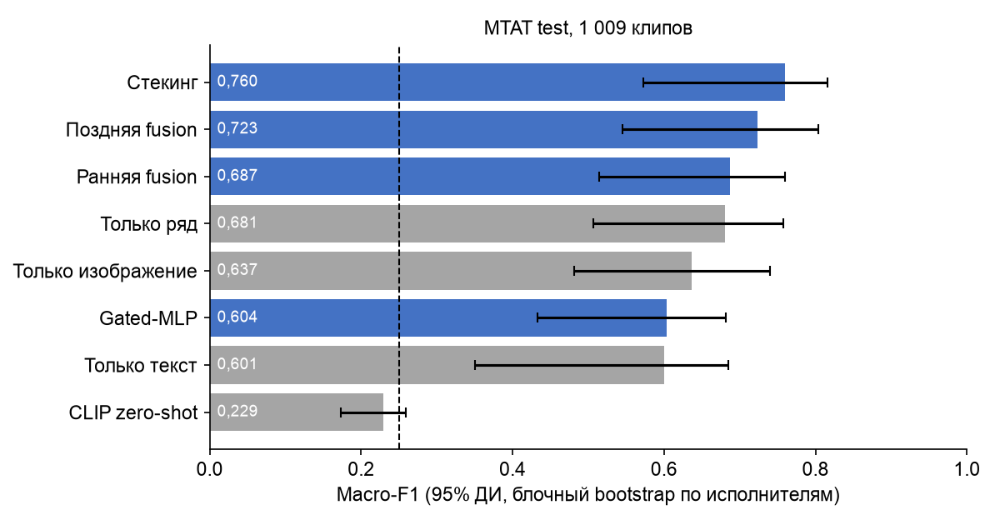

## 4. Единый экспериментальный протокол

| Элемент | Значение |
|---|---|
| Постановка | 4 класса типа фронт-вокала, одна метка на трек |
| Обучение / подбор / тест | MTAT train (5 071) / val (1 019) / test (1 009), разбиение по исполнителям |
| Перенос | SDD/Jamendo, 281 трек, модели обучены только на MTAT train без дообучения |
| Основная метрика | Macro-F1 (↑); дополнительно: accuracy, MCC (↑), AUROC macro one-vs-rest (↑), Brier score (↓), ECE (↓), F1 по классам |
| Интервалы | 95% блочный bootstrap, 1 000 повторов: блоки — исполнители (в тесте 33). Это аналог блочного bootstrap во времени: клипы одного исполнителя зависимы |
| Проверка прироста | парный permutation test для ΔMacro-F1 (5 000 перестановок предсказаний двух моделей по объектам) + блочный bootstrap Δ |
| Случайность | seed = 42 везде (bootstrap, SVD, PyTorch, перестановки) |
| Журнал параметров | `results/params_log.json` |

### Модели и схемы интеграции

| № | Модель / схема | Модальности | Как устроена | Гиперпараметры (подбор на val) |
|---|---|---|---|---|
| M1 | CLIP zero-shot | изображение + текст-промпт | сходство эмбеддинга спектрограммы с 4 текстовыми описаниями классов, без обучения | ViT-B/32 (OpenAI), logit scale 100 |
| M2 | Только текст | текст | TF-IDF (символьные 2–5 + слова 1–2) → логистическая регрессия | C = 10 |
| M3 | Только ряд | ряд | 120 статистик ряда → стандартизация → логистическая регрессия | C = 10 |
| M4 | Только изображение | изображение | CLIP-эмбеддинг (512) → логистическая регрессия | C = 10 |
| M5 | Ранняя fusion | все три | конкатенация [SVD-128 текста, 120 статистик ряда, CLIP-512] → логистическая регрессия | C = 0,03 |
| M6 | Поздняя fusion | все три | взвешенное среднее вероятностей M2–M4, веса на симплексе с шагом 0,1 | текст 0,1 / ряд 0,4 / изображение 0,5 |
| M7 | Стекинг | все три | мета-логистическая регрессия на out-of-fold вероятностях M2–M4 (GroupKFold = 5 по исполнителям) | C = 1 |
| M8 | Gated-MLP (intermediate fusion) | все три | текст MLP + CLIP MLP + BiGRU по ряду (20 шагов) → softmax-гейт весов модальностей → классификатор; modality dropout 0,3 | hidden 128, AdamW lr 1e-3, 15 эпох (early stopping) |

Все логистические регрессии — `class_weight="balanced"`, C из {0,03; 0,1; 0,3; 1; 3; 10}.

## 5. Сравнение моделей (MTAT test, 1 009 клипов)

| Модель | Macro-F1 [95% ДИ] | MCC | AUROC | Brier | ECE | F1 male | F1 female | F1 group | F1 instr. |
|---|---|---|---|---|---|---|---|---|---|
| **M7 Стекинг** | **0,760** [0,573; 0,816] | **0,676** | **0,916** | **0,348** | **0,020** | 0,736 | **0,720** | 0,768 | 0,815 |
| M6 Поздняя fusion | 0,723 [0,545; 0,803] | 0,629 | 0,899 | 0,405 | 0,124 | 0,671 | 0,620 | **0,772** | **0,830** |
| M5 Ранняя fusion | 0,687 [0,514; 0,759] | 0,579 | 0,869 | 0,438 | 0,054 | 0,653 | 0,589 | 0,725 | 0,782 |
| M3 Только ряд | 0,681 [0,507; 0,757] | 0,575 | 0,869 | 0,440 | 0,038 | 0,657 | 0,590 | 0,692 | 0,782 |
| M4 Только изображение | 0,637 [0,481; 0,740] | 0,521 | 0,852 | 0,475 | 0,028 | 0,631 | 0,415 | 0,727 | 0,774 |
| M8 Gated-MLP | 0,604 [0,433; 0,681] | 0,460 | 0,821 | 0,515 | 0,034 | 0,586 | 0,540 | 0,633 | 0,657 |
| M2 Только текст | 0,601 [0,350; 0,685] | 0,464 | 0,781 | 0,567 | 0,069 | 0,463 | 0,608 | 0,667 | 0,664 |
| M1 CLIP zero-shot | 0,229 [0,174; 0,259] | 0,063 | 0,537 | 0,778 | 0,030 | 0,348 | 0,380 | 0,189 | 0,000 |

Интервалы широкие, потому что в тесте только 33 исполнителя, а блочный bootstrap честно учитывает зависимость клипов одного исполнителя. Поэтому сравнение моделей между собой делается **парными** тестами (ниже): они устраняют общую для моделей вариативность «какие исполнители попали в тест».

### Прирост к лучшему unimodal baseline (M3 «Только ряд»)

| Схема | ΔMacro-F1 | 95% ДИ Δ (блочный bootstrap) | p (permutation) | Вывод |
|---|---|---|---|---|
| M7 Стекинг | **+0,079** | [+0,007; +0,131] | 0,0002 | прирост подтверждён |
| M6 Поздняя fusion | +0,043 | [+0,018; +0,079] | 0,0006 | прирост подтверждён |
| M5 Ранняя fusion | +0,007 | [−0,011; +0,022] | 0,40 | прироста нет |
| M8 Gated-MLP | −0,077 | [−0,159; −0,022] | 0,0002 | значимо хуже |

**H1 подтверждена на MTAT:** стекинг и поздняя fusion дают прирост ≥ 0,03, интервал не включает 0.
