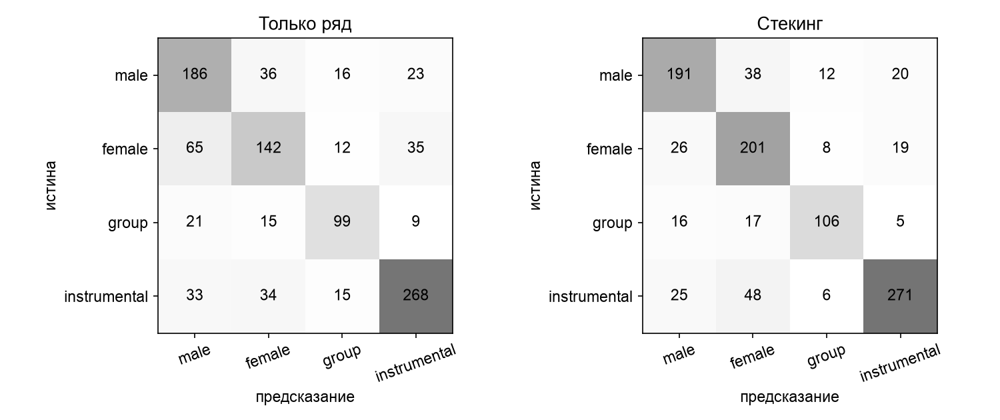

## 6. Абляции и вклад модальностей

### Абляции ранней fusion (модель переобучается на подмножестве модальностей)

| Модальности | Macro-F1 | MCC | Brier |
|---|---|---|---|
| текст + ряд + изображение | 0,687 | 0,579 | 0,438 |
| **ряд + изображение** | **0,710** | **0,612** | **0,404** |
| текст + ряд | 0,681 | 0,571 | 0,441 |
| текст + изображение | 0,613 | 0,486 | 0,495 |
| только ряд | 0,681 | 0,575 | 0,440 |
| только изображение | 0,637 | 0,521 | 0,475 |
| только текст (SVD-128) | 0,430 | 0,238 | 0,664 |

Удаление ряда даёт самое большое падение (0,687 → 0,613). Текст в ранней fusion **мешает** (0,710 без текста против 0,687 с ним): после сжатия SVD-128 он теряет информацию (0,430 против 0,601 у полного TF-IDF) и добавляет шум. Поэтому текст полезен только в поздних схемах, где используется его полная модель M2.

### Permutation importance модальностей (M8, перемешивание модальности между объектами теста, 20 повторов)

| Модальность | Падение Macro-F1 |
|---|---|
| ряд | 0,354 ± 0,011 |
| текст | 0,002 ± 0,002 |
| изображение | 0,000 ± 0,001 |

Средние веса гейта M8: ряд 0,56–0,80, текст 0,17–0,38, изображение 0,03–0,05 (по классам). Совместно обученная сеть **выродилась в модель одного ряда** — то самое доминирование модальности, которое описывают Wang et al. (2020). Поэтому M8 проигрывает: на 5 тысячах примеров она не научилась пользоваться текстом и изображением.

### Устойчивость к пропуску модальности на тесте (модели обучены на всех модальностях)

| Режим | Поздняя fusion M6 | Gated-MLP M8 |
|---|---|---|
| все модальности | **0,723** | 0,604 |
| нет текста | 0,705 | 0,603 |
| нет изображения | 0,696 | 0,601 |
| нет ряда | 0,673 | 0,407 |
| только текст | 0,601 | 0,390 |
| только изображение | 0,637 | 0,466 |
| только ряд | 0,681 | 0,600 |

Для M6 пропавшая модальность исключается, а веса остальных перенормируются. Поздняя fusion теряет не более 0,05 при пропуске любой одной модальности и **остаётся не хуже лучшей одномодальной**. M8, несмотря на modality dropout при обучении, без ряда падает до 0,41. **H4 подтверждена.**

## 7. Анализ ошибок

**Матрицы ошибок** (строки — истина, столбцы — предсказание):

1. **Прирост стекинга создаёт класс female.** Верных female-ответов стало 201 вместо 142, путаница female → male сократилась с 65 до 26 случаев. Текст и изображение исправляют характерную ошибку ряда: по динамике звука высокий мужской и низкий женский голос похожи.
2. **Стекинг исправил 130 ошибок ряда и внёс 56 новых.** Пример исправления: Norine Braun, «Modern Anguish» — ряд и изображение говорят male, текст говорит female, стекинг выбирает female (верно). Исполнителя нет в train: текстовая модель обобщает по символьным n-граммам имени.
3. **Согласие модальностей — индикатор надёжности:**

| Согласие одномодальных моделей | n | Точность стекинга |
|---|---|---|
| все три согласны | 380 (38%) | 0,934 |
| две из трёх | 503 (50%) | 0,712 |
| все разные | 126 (12%) | 0,444 |

Для системы разметки каталога отсюда следует практическое правило: если все модальности согласны, метку можно ставить автоматически (93% точности на 38% треков), остальные треки отправлять на проверку.

4. **Самые частые ошибки стекинга:** instrumental → female (48), male → female (38), female → male (26), instrumental → male (25). Инструментальные треки с «поющими» инструментами (флейта, струнные) путаются с женским вокалом. Пример — Indidginus, «Dusty lands»: все аудио-модальности видят голос.
5. **Шум разметки:** «The lonely minstrel part 1» (Minstrel Spirit) размечен как female, но все три модальности единодушно говорят instrumental. Вероятна ошибка исходного тега или вокал за пределами первых 10 секунд.
