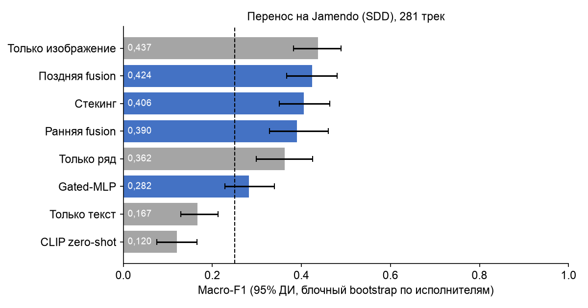

## 8. Применение к авторскому набору (Jamendo / Song Describer)

Все модели обучены на MTAT train и без дообучения применены к 281 треку Jamendo. Это другой каталог (независимые музыканты, релизы 2005–2017 годов, другой жанровый состав), другие исполнители и другой источник меток.

### Находка: несинхронизированные технические параметры ломают временной ряд

Первый запуск дал провал ряда и всех fusion-схем. Причина: аудио MTAT хранится в 16 кГц, поэтому выше 8 кГц в нём нет энергии, а Jamendo полнополосный. Спектральные признаки ряда (центроид, полоса, спад, ZCR) на Jamendo систематически сдвинуты в «высокую» область, которой модель не видела. Спектрограмма ограничена 8 кГц и поэтому почти не пострадала. После правила S4 (Jamendo → 16 кГц → 22,05 кГц):

| Модель | Macro-F1 до | Macro-F1 после | Brier до | Brier после |
|---|---|---|---|---|
| Только ряд | 0,222 | **0,362** | 1,180 | 0,682 |
| Ранняя fusion | 0,249 | 0,390 | 1,110 | 0,641 |
| Поздняя fusion | 0,237 | **0,424** | 0,677 | 0,539 |
| Стекинг | 0,289 | 0,406 | 0,762 | 0,574 |
| Gated-MLP | 0,179 | 0,282 | 0,795 | 0,716 |
| Только изображение | 0,420 | 0,437 | 0,532 | 0,500 |
| Только текст | 0,167 | 0,167 | 0,918 | 0,918 |

### Результаты на авторском наборе (после гармонизации)

| Модель | Macro-F1 [95% ДИ] | AUROC | Brier | ECE |
|---|---|---|---|---|
| **Только изображение** | **0,437** [0,383; 0,489] | 0,754 | **0,500** | 0,053 |
| Поздняя fusion | 0,424 [0,367; 0,481] | 0,762 | 0,539 | **0,044** |
| Стекинг | 0,406 [0,351; 0,463] | **0,779** | 0,574 | 0,127 |
| Ранняя fusion | 0,390 [0,328; 0,461] | 0,732 | 0,641 | 0,113 |
| Только ряд | 0,362 [0,299; 0,425] | 0,729 | 0,682 | 0,196 |
| Gated-MLP | 0,282 [0,228; 0,339] | 0,670 | 0,716 | 0,156 |
| Только текст | 0,167 [0,129; 0,212] | 0,482 | 0,918 | 0,346 |
| CLIP zero-shot | 0,120 [0,075; 0,165] | 0,570 | 0,781 | 0,159 |

### Прирост по периодам релиза (permutation test, ΔMacro-F1)

| Период | n | Поздняя fusion vs изображение | Стекинг vs изображение | Поздняя fusion vs ряд |
|---|---|---|---|---|
| 2005–2009 | 130 | −0,062 (p = 0,071) | −0,095 (p = 0,001) | +0,085 (p = 0,028) |
| 2010–2017 | 151 | +0,027 (p = 0,44) | +0,027 (p = 0,47) | +0,045 (p = 0,035) |
| весь набор | 281 | −0,013 (p = 0,59) | −0,031 (p = 0,20) | +0,062 |

**Точность по классам на Jamendo:** instrumental 0,90 (поздняя fusion), female 0,60, male 0,44, group 0,00. Класс group не распознаётся ни одной моделью: метка group в Jamendo шумная, а хоровой музыки (церковные хоры, опера), на которой group выучен в MTAT, в Jamendo почти нет.

### Выбор и применение лучшей схемы

**Правило выбора:**
1. К выбору допускаются схемы fusion с положительным приростом к лучшему unimodal на MTAT test, у которых 95% интервал прироста не включает 0. Проходят M7 (стекинг) и M6 (поздняя fusion).
2. Среди допущенных выбирается схема, которая на отложенном периоде (Jamendo 2010–2017) не хуже лучшей одномодальной модели, а при равенстве — более устойчивая к пропуску модальности и лучше калиброванная.

**Выбрана M6 — поздняя fusion.**
- На MTAT она даёт +0,043 [+0,018; +0,079].
- На позднем периоде Jamendo она на 0,027 выше изображения (незначимо) и значимо выше ряда.
- Она лучше всех калибрована на Jamendo (ECE 0,044) и теряет не более 0,05 при пропуске любой модальности.

Стекинг точнее на MTAT (0,760), но на Jamendo сильнее деградирует (2005–2009: −0,095 к изображению, p = 0,001) и хуже калиброван. Это признак переобучения мета-модели на распределение MTAT.

**Требование задания «прирост на отложенном периоде» строго не подтверждено:** ни одна схема fusion не даёт значимого прироста к лучшей одномодальной модели (изображение) на Jamendo. Гипотеза **H3 отвергнута**.
